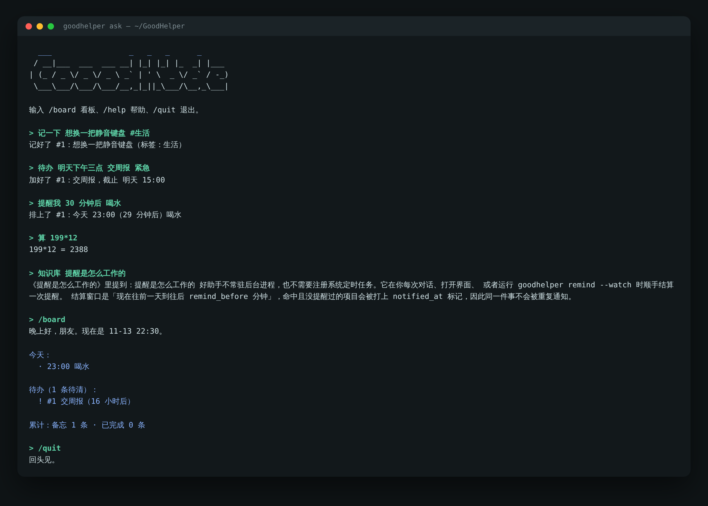
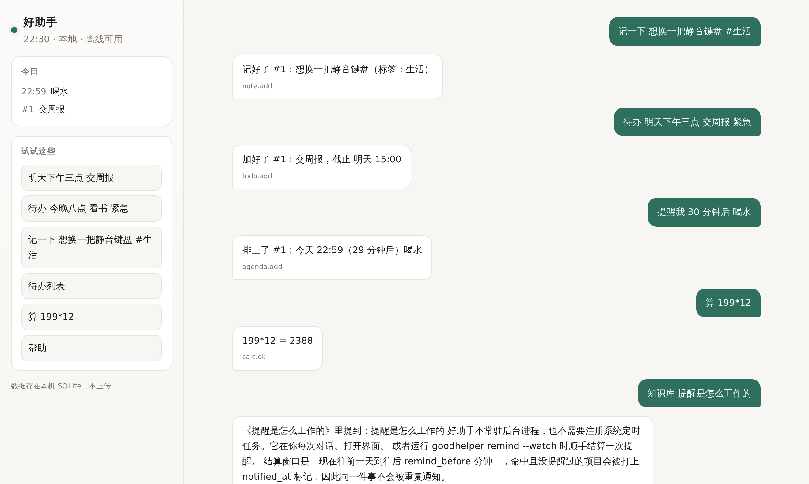

# 好助手 GoodHelper

命令行对话：



浏览器界面：



一只装在自己机器上的助手：**记下来、排上号、按时提醒，顺便查自己的笔记**。

- 纯 Python 标准库实现，零第三方依赖，`python3 -m goodhelper` 直接跑
- 数据全部落在本机 SQLite（`~/.goodhelper/goodhelper.db`），不联网、不上传
- 一个引擎，三套入口：命令行对话、今日看板、浏览器界面
- 能力做成插件，加一个文件就多一项本事

版本与变更见 [CHANGELOG.md](CHANGELOG.md)。

## 快速开始

```bash
git clone <repo> && cd GoodHelper

python3 -m goodhelper init          # 生成配置与知识库目录
python3 -m goodhelper ask           # 进入对话
python3 -m goodhelper board         # 今日看板
python3 -m goodhelper serve         # http://127.0.0.1:8321 浏览器界面
```

要求 Python 3.11+（用到了标准库 `tomllib`）。

## 它会什么

```
> 记一下 想换一把静音键盘 #生活
记好了 #1：想换一把静音键盘（标签：生活）

> 待办 明天下午三点 交周报 紧急
加好了 #1：交周报，截止 明天 15:00

> 提醒我 10 分钟后喝水
排上了 #1：今天 20:35（10 分钟后）喝水

> 算 199*12
199*12 = 2388

> 知识库 怎么配置流水线
《流水线》里提到：云原生构建用 .cnb.yml 描述流水线……
```

| 插件 | 能听懂的话 |
| --- | --- |
| 速记 | `记一下 …`、`备忘列表`、`搜备忘 咖啡`、`删掉备忘 3` |
| 待办 | `待办 明天下午三点 写周报 紧急`、`待办列表`、`完成 3`、`顺延 3 两天`、`清理已完成` |
| 日程 | `明天下午三点 开会`、`提醒我 10 分钟后喝水`、`日程 3 天`、`下一件事`、`取消日程 2` |
| 知识库 | `知识库 你的问题`、`知识库状态` |
| 计算 | `算 12*(3+4)`、`1+1` |
| 帮助 | `帮助`、`你是谁` |

没命中规则的话，它会先接住这句话；如果句子里带时间，就直接排成日程。

### 它怎么理解时间

中文口语为主，解析顺序是「相对偏移 → 日期词 → 星期 → 具体日期 → 时点」：

- `10 分钟后`、`三天后`、`两周后`
- `今天`、`明天`、`后天`、`今晚`、`明晚`
- `周五 18:00`、`下周一 9:00`
- `3月1日 开会`（已过则算明年）
- `晚上八点`、`下午三点半`、`中午`、`明天上午`

## 提醒怎么送到你面前

不需要常驻后台，也不需要注册系统定时任务。三处会顺手结算一次：

1. 每次 `goodhelper ask` 或打开浏览器界面
2. `goodhelper remind` 手动结算一次
3. `goodhelper remind --watch --interval 30` 常驻盯着

提醒过的项目会打上标记（`notified_at`），不会重复打扰。

## 配置

`~/.goodhelper/config.toml`（`goodhelper init` 会生成）：

```toml
[assistant]
name = "好助手"
user_name = "朋友"
remind_before = 10      # 提前多少分钟提醒

[web]
host = "127.0.0.1"
port = 8321

[plugins]
enabled = ["note", "todo", "agenda", "kb", "calc", "help"]
```

换数据目录：`export GOODHELPER_HOME=/your/path`；指定配置文件：`goodhelper -c ./my.toml …`。

## 知识库

把 Markdown / 纯文本扔进 `~/.goodhelper/kb/`，就能问它：

```bash
cp examples/kb/*.md ~/.goodhelper/kb/
python3 -m goodhelper ask "知识库 提醒是怎么工作的"
```

检索用的是 BM25（自己实现的，`goodhelper/plugins/kb.py`），中文按单字、英文按词切分，
按标题分块入库，返回命中最高的片段原文和出处。

## 写一个插件

新建 `goodhelper/plugins/weather.py`：

```python
from goodhelper.core.plugin import Reply, Rule, SimplePlugin


def _say(ctx, match):
    city = match.group("city")
    return Reply(f"{city}今天适合带伞。", "weather.lookup")


PLUGIN = SimplePlugin(
    name="weather",
    title="天气",
    help=["天气 北京"],
    rules=[Rule("weather.lookup", r"^天气\s*(?P<city>.+)$", _say)],
)
```

把 `"weather"` 加进配置的 `plugins.enabled` 即可，不用改路由、不用改界面。

## 项目结构

```
goodhelper/
├── cli.py              # 命令行入口
├── core/
│   ├── brain.py        # 意图路由 + 兜底对话
│   ├── clock.py        # 中文时间解析
│   ├── config.py       # TOML 配置
│   ├── board.py        # 看板快照与渲染
│   ├── scheduler.py    # 提醒结算
│   ├── service.py      # CLI/Web 共用的门面
│   ├── store.py        # SQLite 存储
│   └── plugin.py       # 插件协议与自动发现
├── plugins/            # 内置能力
└── web/                # 标准库 HTTP 服务 + 静态页面
```

## 开发

```bash
python3 -m unittest discover -s tests -t . -v
```

## 数据与隐私

全部数据在本地 `goodhelper.db`，一条命令备份：

```bash
goodhelper export -o backup.json
```
